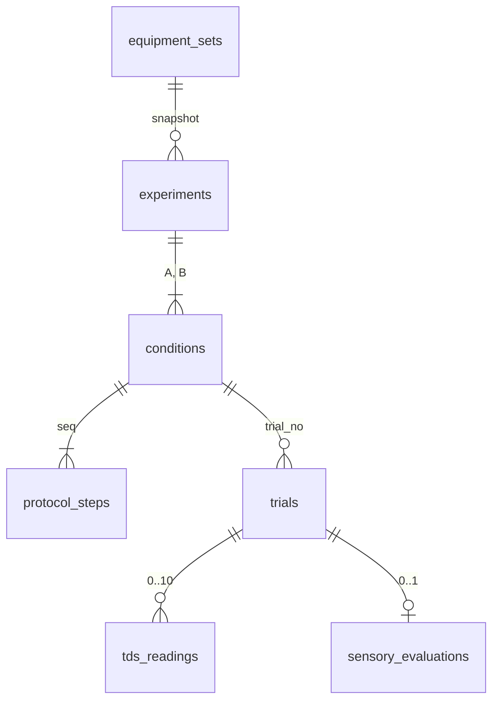

# Coffee Log Web

自宅でのコーヒー抽出を「実験」として計画・記録し、抽出条件と測定結果（TDS・抽出率・官能評価）の関係を、ばらつきと限界を含めて比較するFastAPI製Webアプリです。

一社目のBackend / Web Engineer就活で提示する主成果物として、ドメインモデル、DB制約、transaction、validation、測定値と派生値の分離、テストを説明できることを目的にしています。

## 作成理由と方針転換

当初は「抽出記録 → 評価 → ルールベースの改善提案」のアプリでした（タグ `legacy-v1-recommendation`）。2026-11-04に次の理由で目的を変えました。

1. 抽出全体に固定したパラメータ（湯温1つ、蒸らし時間1つ）では、多様な抽出方法を表現できない
2. 科学的根拠が不十分な改善提案を、アプリの中心機能にしたくない
3. 条件を変えたときの影響を、自分の器具と測定で確かめたい

対象ユーザーは、屈折計などでTDSを測り、抽出を本格的に検証したい個人1人です。推薦や自動最適化はしません。

## AIの利用と担当範囲

現在のコード（2026-11-04以降の再設計版）は、AI（Claude）が実装しました。commitのauthorが `Claude` のものがAIの変更です。

| 作業 | 担当 |
| --- | --- |
| アプリの目的・対象ユーザーの決定（上の方針転換） | 本人 |
| MVP仕様の文書化 | AIが下書きし、主要な設計判断（工程を正規化テーブルで持つ、総合点の尺度、推薦・外部ベンチマークの廃止、CSVエクスポートを後回し）は本人が確認して採用 |
| 実装・テスト・README（再設計版） | AI |
| 各Pull Requestのmerge | 本人 |

## Core Vertical Slice

```text
実験作成（2条件＋抽出工程）
→ 試行記録（TDS・飲料重量・官能評価）
→ 条件比較（記述統計・2種のばらつき・注意）
```

例：「50℃で蒸らす（A）」と「93℃で蒸らす（B）」を交互に3杯ずつ淹れ、TDSを1杯につき2回測り、TDS・EY・味の評価とそのばらつきを比べます。この流れは `tests/test_acceptance_scenario.py`（HTTP）と `tests/e2e/test_browser_flow.py`（実サーバー＋ブラウザ）で自動化しています。

## 画面

| パス | 内容 |
| --- | --- |
| `/` | ホーム |
| `/pages/equipment-sets` | 器具セットの一覧・登録・編集・非表示 |
| `/pages/experiments` | 実験一覧 |
| `/pages/experiments/new` | 実験作成。条件Aの工程を入力し、Bへ複製して1か所だけ変える。差分を即時表示 |
| `/pages/experiments/{id}` | 実験詳細。A・Bの工程（差分のセルを強調）、試行一覧、次に淹れる条件 |
| `/pages/experiments/{id}/trials/new` | 試行の記録。次の条件を初期選択、TDSの複数回測定、官能評価 |
| `/pages/trials/{id}` | 試行の詳細と編集。派生値、逸脱・除外、TDS測定の追加・削除、官能評価 |
| `/pages/experiments/{id}/comparison` | 条件比較 |

## ドメインモデル



| 実体 | 役割 |
| --- | --- |
| Experiment | 仮説と固定条件（豆・焙煎日・器具・抽出方式・水・TDS計測器）の単位 |
| Condition | 比べる計画（粉量・挽き目・工程）。1実験にA・Bの2つ |
| ProtocolStep | 計画工程の1操作（注湯・攪拌・その他） |
| Trial | 1回の抽出の事実（実測粉量・飲料重量・抽出時間・逸脱・除外） |
| TdsReading | 同じ飲料を測った1回のTDS |
| SensoryEvaluation | 総合点（1〜10）と属性の強さ（0〜5）、盲検の有無 |

### 主な設計判断

- **計画（Condition）と実行（Trial）を分ける。** 1杯ごとに全条件を保存する方式だと、「同じ条件の反復」がデータ上で定義できず、計画からの逸脱も検出できない。
- **試行が付いた計画は変更不可（409）。** 過去の試行がどの計画で淹れられたかを失わないため。変更したい場合は新しい実験を作る。
- **工程はJSON列ではなく正規化テーブルで持つ。** 工程の種類ごとの必須・禁止項目（注湯なら湯量と温度、攪拌なら方法）をDBのCHECKでも保証し、条件間の差分を工程単位で出すため。JSON列は実装が小さい反面、形式のずれをDBで止められない。
- **待機は工程の種類にしない。** 次の工程の開始時刻までの空白が待機であり、明示すると時刻の重なりや矛盾の検査が増える。
- **温度は「ケトル温度」として記録する。** 制御できるのは注湯直前のケトル内の湯温で、粉と湯が接する温度（スラリー温度）ではない。
- **1変数実験を支援するが強制しない。** 変更変数は本人が宣言し、アプリは計画の差分を自動算出する。差分が2項目以上なら注意を出すが、保存は拒否しない。

## 測定値と派生値

保存するのは測定値だけです。次の値は読み出しのたびに `app/domain` の純粋関数で計算し、応答では `measured` と `derived` に分けて返します。測定値を訂正すれば派生値も即時に変わり、再計算漏れが起きません。

| 派生値 | 計算 |
| --- | --- |
| TDS平均・測定のSD | 1杯のTDS測定値の平均と標本SD |
| EY | `BEVERAGE_MASS_V1`：EY(%) = TDS平均(%) × 飲料重量(g) ÷ 実測粉量(g) |
| 焙煎後日数 | 抽出日時をAsia/Tokyoの日付に直し、焙煎日との差を数える |
| 実験の状態・次の条件 | 試行の有無と数から決める（「完了」などの手動操作を求めない） |

EYの式は粉に残った液を数えないため、透過式の近似です。浸漬式・ハイブリッドでは過小評価になり得るので、比較で注意を出します。TDSか飲料重量がない場合、EYは `null` とし、理由（`NO_TDS_READING` / `NO_BEVERAGE_MASS`）を返します。計画粉量は実測粉量の代わりに使いません。

## 比較（`GET /experiments/{id}/comparison`）

- 指標：TDS、EY、飲料重量、抽出時間、総合点、5属性
- 条件ごとに全値（抽出順）・n・平均・標本SD（n<2はnull）・中央値・最小・最大と、B−Aの平均差
- **TDSのばらつきを2種類に分ける。** 同じ飲料の反復測定のばらつき（試行内分散を自由度で重み付けしたプールSD）と、試行ごとのTDS平均のばらつき。前者が後者と同程度なら、杯ごとの違いは測定誤差と区別できない
- 除外した試行は常に数えない。逸脱した試行は `include_deviated=true` のときだけ数える
- **「有意」「効果あり」などの判定は出さない。** 1条件数杯では標準偏差の推定が不安定で、検定の前提も確かめにくい。数値と注意コードを並べ、解釈は利用者に委ねる

| 注意コード | 条件 |
| --- | --- |
| `N_SMALL` | いずれかの条件で n < 5（運用上の目安） |
| `ORDER_CONFOUNDED` | 片方の条件をすべて淹れてから他方を淹れた（豆の経時変化などと区別できない） |
| `MULTIPLE_VARIABLES_CHANGED` / `NO_DIFFERENCE_IN_PLAN` | 計画の差分が2項目以上 / 0項目 |
| `NOT_BLINDED` | 条件を知ったまま評価した杯がある |
| `DEVIATED_OR_EXCLUDED` | 比較から外した試行がある（件数付き） |
| `MEASUREMENT_REPEATS_MISSING` | 2回以上測った試行がなく、測定のばらつきを分けられない |
| `EY_METHOD_ASSUMPTION` | 透過式以外で、飲料重量法のEYが過小評価になり得る |

## API

JSONのAPIです。リクエスト・応答の全項目はアプリ起動後の `/docs`（OpenAPI）にあります。POSTによる作成は201、PUT（官能評価の作成または置換、計画の置換）とPATCHは200、削除は204（器具セットは論理削除のため200で更新後の値）を返します。

```text
GET    POST          /equipment-sets
GET    PATCH  DELETE /equipment-sets/{id}

GET    POST          /experiments
GET    PATCH  DELETE /experiments/{id}
GET                  /experiments/{id}/comparison?include_deviated=false
PATCH                /conditions/{id}
PUT                  /conditions/{id}/protocol

POST                 /conditions/{id}/trials
GET    PATCH  DELETE /trials/{id}
POST                 /trials/{id}/tds-readings
DELETE               /tds-readings/{id}
PUT           DELETE /trials/{id}/sensory
```

### 主な応答の形

- `GET /trials/{id}`：`measured`（`dose_g_actual`・`beverage_mass_g`・`brew_time_s`・`tds_readings`）と `derived`（`tds_mean_pct`・`tds_reading_sd_pct`・`ey_pct`・`days_since_roast`・`planned_total_water_g`）に分けて返す。`tds_readings` の各要素は `id` を持ち、`DELETE /tds-readings/{id}` で1件ずつ消せる
- `GET /experiments/{id}/comparison`
  - `conditions[]`：条件ごとの `included_trial_count` と、指標ごとの `n`・`values[{trial_id, trial_no, brewed_at, value}]`・`mean`・`sd`・`median`・`min`・`max`
  - `tds_variability.{A,B}`：`measurement_sd`（`value`・`groups_used`（2回以上測った試行の数）・`degrees_of_freedom`）と `between_trial_sd`（`value`・`n`）
  - `differences.{指標}.mean_b_minus_a`：B−Aの平均差。どちらかに値がなければ `null`
  - `warnings[]`：`{code, count}`（`count` は `DEVIATED_OR_EXCLUDED` だけが持つ）
- エラー：本文は常に `{"detail": ...}`。422の `detail` は `loc`・`msg`・`type` を持つ要素の配列（入力の検証とPATCHをmergeした後の検証で同じ形）、400・404・409の `detail` は理由の文字列

### HTTPステータス

| 状況 | Status |
| --- | ---: |
| 入力の検証エラー、PATCHをmergeした後の検証エラー | 422 |
| 資源がない、非表示の器具セットを指定 | 404 |
| PATCHの更新項目が空 | 400 |
| 試行がある計画・固定条件の変更、試行がある実験の削除、TDS測定が10件を超える | 409 |

### Validationと整合性

- 工程：1〜50件、注湯を1件以上、最初の注湯は0秒、開始時刻は非減少、注湯どうしは重ならない、種類ごとの必須・禁止項目
- 精度：質量・TDSは小数2桁、温度は1桁まで。超える入力は丸めずに422
- 試行：計画から逸脱したら逸脱の内容、除外したら理由が必須。官能評価は1項目以上
- PATCH：省略は維持、nullable項目への `null` はクリア、空は400。保存済みの値とmergeした全体を検証してから保存する
- 日時：入力はoffset付き（RFC 3339）が必須で、UTCで保存・応答する。画面ではAsia/Tokyoで表示する
- DB：`PRAGMA foreign_keys = ON`、CHECK・UNIQUE制約。実験→条件→工程はCASCADE、試行がある実験の削除はRESTRICT、試行→TDS測定・官能評価はCASCADE
- Transaction：実験の作成（実験・条件・工程）、計画の置換、試行の作成（試行・TDS測定・官能評価）はそれぞれ1 transaction。「試行があるか」の確認と更新は同じ `BEGIN IMMEDIATE` の中で行う

## 構成

```text
app/
├── main.py            アプリの組み立て（router登録、例外ハンドラ、static）
├── config.py          表示・日付計算に使うタイムゾーン
├── db.py              SQLite接続、transaction、schema
├── errors.py          業務エラーとHTTPステータスの対応
├── domain/            純粋関数（工程の検証、差分、EY、統計、比較、警告）
├── schemas/           Pydanticのrequest / response
├── repositories/      SQLだけを持つ。commitしない
├── services/          業務規則とtransactionの範囲
├── routers/           HTTP APIと画面のroute
├── presentation.py    画面の表示ラベル・桁数・注意の文言
└── templating.py      Jinja2と表示用フィルタ
templates/, static/    画面（Jinja2 + 最小限のJavaScript）
tests/                 domain・DB制約・API・受入・画面のテスト
tests/e2e/             実サーバー＋ブラウザのE2E
```

- router：HTTPの入出力だけを扱い、serviceを呼ぶ
- service：存在確認・更新可否などの業務規則と、transactionの範囲を決める。HTTPに依存しない業務エラーを送出する
- repository：SQLだけを持つ。更新できる列は許可リストで限定する
- domain：DB・HTTP・Pydanticに依存しない。規則を単体テストで守る

技術：Python 3.12、FastAPI、Pydantic v2、SQLite、Jinja2、pytest、Playwright（E2E）、GitHub Actions。

## ローカル実行

```bash
python -m venv .venv
source .venv/bin/activate          # Windows PowerShell: .\.venv\Scripts\Activate.ps1
pip install -r requirements.txt
uvicorn app.main:app --reload
```

- 画面：`http://127.0.0.1:8000/`
- API Docs：`http://127.0.0.1:8000/docs`

起動時にSQLiteのschemaを作成します。DBファイルは既定でリポジトリ直下の `coffee_log_web.db` で、環境変数 `COFFEE_LOG_DB_PATH` で変えられます。移行前のDBファイルを使い続けても動きますが、旧テーブル（`brew_logs` など）は参照しません。

## テスト

```bash
pip install -r requirements-dev.txt
python -m pytest -q
```

| 種類 | ファイル | 内容 |
| --- | --- | --- |
| domain | `tests/test_domain_*.py` | 工程の検証、差分、EY、統計、比較、状態、警告を手計算の値と照合 |
| DB制約 | `tests/test_db_schema.py` | 生SQLで不正な行を入れると `IntegrityError` になること |
| API | `tests/test_*_api.py` | 作成・更新・削除、409、PATCHのmerge検証、途中失敗時に何も残らないこと |
| 受入 | `tests/test_acceptance_scenario.py` | 50℃／93℃の受入シナリオをHTTPだけで実行し、比較の全数値を照合 |
| 画面 | `tests/test_pages.py` | 各画面が担当する値を含むこと、埋め込みJSが構文として正しいこと（`node` がある場合） |
| E2E | `tests/e2e/` | 実サーバーとChromiumで、器具登録→実験作成→試行4杯→比較→除外を操作 |

E2Eは `E2E_BASE_URL` を設定したときだけ実行します。

```bash
pip install -r requirements-e2e.txt
python -m playwright install chromium
COFFEE_LOG_DB_PATH=/tmp/e2e.db uvicorn app.main:app --port 8001 &
E2E_BASE_URL=http://127.0.0.1:8001 python -m pytest -q tests/e2e
```

CI（`.github/workflows/tests.yml`）はpushとpull requestごとに、clean checkout → 依存の導入 → `compileall` → pytest → uvicornの起動確認、と別ジョブでE2Eを実行します。

## 対象外

| 項目 | 理由 |
| --- | --- |
| AIによる改善提案・自動最適化 | 目的は検証であり、提案ではない |
| 統計的検定による判定、区間推定 | 判定語を出さない方針。不確実性は記述統計と注意で示す |
| 測定器との自動連携 | 機器ごとに方式が異なり、手入力で検証は成立する |
| 認証・多ユーザー・SNS | 対象が個人1人 |
| 条件3つ以上、Recipeライブラリと版管理、実際に行った工程の記録、浸漬式のEY式、CSVエクスポート、可視化 | 完成形の範囲。MVPの次の候補はCSVエクスポート |
| React / Next.js、PostgreSQL、Docker、デプロイ | 技術の刷新は検証の目的に寄与しない |

条件をA・Bの2つに限る制約とEY方式の制約はDBのCHECKで持っているため、拡張するときはSQLiteのテーブルを作り直す必要があります。
